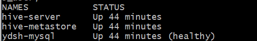
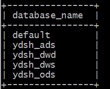
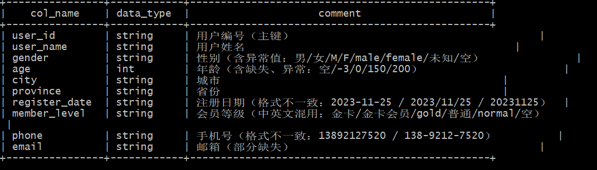

# 环境搭建笔记

> 记录环境搭建过程中的配置、遇到问题与解决方案，作为交付物之一。
> 文档随实践过程持续更新。

---

## 一、本机环境基线

| 项目 | 版本 / 配置 | 备注 |
|---|---|---|
| 操作系统 | Windows 11（Build 26100） | 64 位 |
| Docker Desktop | 4.73.1（build 226574） | 引擎 29.4.3 |
| Docker Compose | v5.1.3 | **命令为 `docker-compose`（横杠）** |
| Docker 引擎 | 29.4.3，overlayfs 驱动 | kernel 6.6.114.1-microsoft-standard-WSL2 |
| WSL 后端 | WSL 2 | 虚拟机内存 8 GB，CPU 16 |
| Docker 数据目录 | `G:\Work\resources\DockerDesktopWSL` | 已占用约 26 GB |
| C 盘可用空间 | 约 20 GB（已用 89%） | 空间偏紧，注意镜像清理 |
| G 盘可用空间 | 约 147 GB（已用 54%） | Docker 数据盘所在盘 |
| Git | 2.55.0.windows.3 | 终端使用 Git Bash |

**端口占用情况**（启动容器前已核查，避免冲突）：

| 端口 | 状态 | 占用者 | 处理方式 |
|---|---|---|---|
| 3306 | 已占用 | 本地 MySQL 服务（`MySQL80`） | 容器映射到 **13306** |
| 10000 | 空闲 | — | HiveServer2 JDBC |
| 10002 | 空闲 | — | HiveServer2 Web UI |
| 9083 | 空闲 | — | Hive Metastore |
| 80 / 443 | 已占用 | 既有 Dify 容器（nginx） | 本项目不使用 |

| Hive | apache/hive 4.0.0 | 待启动 |
| MySQL | 8.0 | 待启动 |

---

## 二、环境搭建步骤

### 步骤 1：启动 Docker Desktop

**操作**：双击 Docker Desktop 图标启动，等待左下角状态变为 Engine running。

**验证命令**：

```bash
docker --version
docker info --format '{{.ServerVersion}}'
```

**验证通过标准**：两条命令均输出版本号，无报错。实测首次启动约 20 秒引擎就绪。

---

### 步骤 2：编写 docker-compose.yml 启动 Hive + MySQL

**文件位置**：`docker/docker-compose.yml`

**编排要点**（Hive 4.0.0 官方镜像的必需配置）：

1. **启动顺序**：`mysql` → `hive-metastore` → `hive-server`，用 `depends_on` + healthcheck 控制
2. **Metastore 必须连 MySQL**：需显式指定 `SERVICE_NAME=metastore`、`DB_DRIVER=mysql`、
   `SERVICE_OPTS` 中配置 JDBC 连接串（Hive 4.0 不再使用旧版 `HIVE_SITE_CONF_*` 变量）
3. **HiveServer2 复用同一份 hive-site.xml**：两个容器需挂载同一份配置目录，保证 Metastore URI 一致
4. **数据目录挂载**：宿主机 `../data` → 容器 `/data`，供 `LOAD DATA LOCAL INPATH` 使用
5. **MySQL 需预建 metastore 库**并授权，否则 Metastore 首次启动会因找不到 schema 失败

#### 2.1 本项目实际配置（含三个针对性调整）

**调整一：MySQL 容器端口改为 13306**

本机已安装 MySQL 8.0 服务（服务名 `MySQL80`）并占用 3306，若容器也映射 3306 会启动失败。
故容器对外映射 `13306:3306`；容器之间仍通过服务名 `mysql` + 容器内端口 `3306` 通信，
宿主机端口只影响外部客户端连接。

```yaml
ports:
  - "13306:3306"
```

**调整二：外挂 MySQL JDBC 驱动**

`apache/hive:4.0.0` 镜像内置的只有 Derby 驱动，**不含 MySQL 驱动**。
必须下载 `mysql-connector-j` 并挂载到镜像的 lib 目录，否则 Metastore 启动时报
`ClassNotFoundException: com.mysql.cj.jdbc.Driver`。

```bash
# 驱动下载（一次性，已纳入版本库 docker/jdbc/）
curl -L -o docker/jdbc/mysql-connector-j-8.4.0.jar \
  https://repo1.maven.org/maven2/com/mysql/mysql-connector-j/8.4.0/mysql-connector-j-8.4.0.jar
```

```yaml
volumes:
  - ./jdbc/mysql-connector-j-8.4.0.jar:/opt/hive/lib/mysql-connector-j.jar:ro
```

**调整三：JDBC 连接串必带 `allowPublicKeyRetrieval=true`**

MySQL 8 默认认证插件为 `caching_sha2_password`。若连接串缺少该参数，
驱动会报 `Public Key Retrieval is not allowed` 而连接失败。完整连接串：

```
jdbc:mysql://mysql:3306/metastore_db?createDatabaseIfNotExist=true&useSSL=false
  &allowPublicKeyRetrieval=true&serverTimezone=Asia/Shanghai&characterEncoding=UTF-8
```

#### 2.2 两个角色的 `IS_RESUME` 差异（易错点）

| 容器 | `IS_RESUME` | 原因 |
|---|---|---|
| `hive-metastore` | **不设**（默认 false） | 首次启动需执行 `schematool -initSchema` 初始化元数据表结构 |
| `hive-server` | **`"true"`** | 表结构由 metastore 负责，此处必须跳过，否则重复初始化报错 |

#### 2.3 启动与验证

```bash
cd docker
cp .env.example .env        # 可选，不建也能用默认值
docker-compose up -d
docker-compose ps
```

首次启动需拉取镜像（约 3 GB），并等待 Metastore 初始化元数据库，约 1～3 分钟。

**验证通过标准**：

```bash
# ① 三个容器均为 Up
docker ps --format 'table {{.Names}}\t{{.Image}}\t{{.Status}}'

# ② HiveServer2 可连接
docker exec -it hive-server beeline -u jdbc:hive2://localhost:10000 -e "show databases;"

# ③ Web UI 可访问（浏览器打开）
#    http://localhost:10002
```

---

### 步骤 3：连接 Hive 并验证可用

```bash
docker exec -it hive-server beeline -u jdbc:hive2://localhost:10000
```

```sql
show databases;
create database if not exists ydsh_ods;
```

**验证通过标准**：能进入 beeline 交互界面，`show databases;` 返回 `default` 等库，创建 `ydsh_ods` 成功。

---

### 步骤 4：Git 初始化与版本管理

```bash
git config --global user.name "张宇翔"
git config --global user.email "3102976249@qq.com"
ssh-keygen -t ed25519 -C "3102976249@qq.com"
cat ~/.ssh/id_ed25519.pub          # 复制公钥到代码托管平台

git init
git add .
git commit -m "feat: 初始化项目结构"
git branch -M main
git remote add origin <远程仓库地址>
git push -u origin main
```

**验证通过标准**：远程仓库能看到首次提交记录。

---

### 步骤 5：编写 .gitignore

忽略数据文件（`data/`、`模拟数据/`、`*.csv`）、密钥（`.env`、`*.key`）、
日志（`*.log`）、Python 缓存（`__pycache__/`）、编辑器目录（`.idea/`、`.vscode/`）。

**验证通过标准**：`git status` 不再显示 CSV、.env 等被忽略文件的改动。

---

## 三、问题与解决方案记录

> 按「现象 → 排查 → 根因 → 解决」四段式记录，答辩时可作为亮点。

### 问题 1：`docker compose` 子命令不存在

- **现象**：执行 `docker compose version` 报 `docker: unknown command: docker compose`
- **排查**：`docker-compose --version` 可正常输出版本 v5.1.3；检查 `C:\Program Files\Docker\cli-plugins`
  发现 `docker-compose.exe` 存在但未被 CLI 识别为 compose 子命令
- **根因**：当前 Docker CLI 版本下 compose 插件未注册为 `docker compose` 子命令形式
- **解决**：全项目统一改用 `docker-compose`（带横杠）写法，功能完全等价

---

### 问题 2：`docker pull` 报 `unexpected media type text/html`

- **现象**：`docker pull alpine:3.19` 报
  `failed to unpack image on snapshotter overlayfs: unexpected media type text/html`
- **排查**：逐条测试 `~/.docker/daemon.json` 中配置的 21 个 `registry-mirrors`，
  用 `curl -m 8 -o /dev/null -w "%{http_code}" <mirror>/v2/` 探测存活情况
- **根因**：21 个镜像源中仅 1 个可正常返回镜像清单，其余多为超时或返回 HTML 错误页；
  其中包含未替换的占位符 `https://your_preferred_mirror`。Docker 把错误页 HTML 误当作镜像层解析
- **解决**：确认可用镜像源后按需调整 `registry-mirrors` 列表（**调整前务必备份 daemon.json**）

---

### 问题 3：本机 3306 端口被本地 MySQL 占用

- **现象**：`docker-compose up -d` 启动 MySQL 容器时报端口绑定失败
- **排查**：`netstat -ano | grep ":3306 "` 发现 3306 已被监听；
  定位 PID 后 `tasklist` 确认为 `mysqld.exe`；`net start` 输出中可见服务名 `MySQL80`
- **根因**：本机已安装并运行 MySQL 8.0 独立服务，与容器默认映射的 3306 冲突
- **解决**：容器映射改为 `13306:3306`。容器间通信走服务名 + 容器内端口 3306，不受影响；
  仅需注意外部客户端（如宿主机 beeline、Navicat）连接时使用 13306

---

### 问题 4：强制结束 Docker 进程后 WSL 实例卡死

- **现象**：用 `Stop-Process -Force` 结束 Docker 进程后重启，引擎持续报
  `still waiting for init control API to respond after 3m40s`、`GET /ping context deadline exceeded`
- **排查**：`com.docker.backend.exe.log` 中可见 `init control API` 无响应；
  尝试 `DockerCli.exe -Shutdown` 无法正常退出进程
- **根因**：强杀进程导致 WSL 虚拟机内 init 进程未正常退出，实例处于僵死状态
- **解决**：管理员权限执行 `wsl --shutdown` 后重新启动 Docker Desktop；
  若仍无效则重启主机。**结论：不要强杀 Docker 进程，优先用 GUI 的 Quit 或 `DockerCli.exe -Shutdown`**

---

### 问题 5：CSV 为 CRLF 换行，Hive 导入后末字段残留 `\r`

- **现象**：建表使用默认 `LINES TERMINATED BY '\n'` 时，`channel` 字段实际值为 `APP\r`，
  按渠道分组会出现重复枚举值。危险之处在于 `COUNT(*)`、`SELECT *` 看起来都正常，
  只有做枚举分组时才暴露，排查成本很高
- **排查**：用二进制方式读取 CSV 前 3 KB 统计 `\r\n` 与 `\n` 出现次数，确认 6 张表全部为 CRLF
- **根因**：源文件由 Windows 环境导出，行尾为 CRLF；用 `'\n'` 分隔后 `\r` 被并入最后一个字段
- **错误的解法（重要，别走这条弯路）**：直觉上会想改用
  `LINES TERMINATED BY '\r\n'`，**但 Hive 根本不支持多字符行分隔符**，建表阶段直接报错：

  ```
  FAILED: SemanticException LINES TERMINATED BY only supports newline '\n' right now.
  ```

  该限制硬编码在 `BaseSemanticAnalyzer` 中，见 Apache JIRA
  [HIVE-5999](https://issues.apache.org/jira/browse/HIVE-5999) /
  [HIVE-11996](https://issues.apache.org/jira/browse/HIVE-11996)，
  2013 年提出，至今（Hive 4.x）状态仍为 Open / Unresolved。
- **正确解法**：**导入前先把 CSV 的 CRLF 转成 LF**，建表用默认 `'\n'`。
  本项目封装为预处理脚本 `scripts/prepare_data.py`，同时完成三件事：

  ```bash
  python scripts/prepare_data.py            # 模拟数据/ → data/
  python scripts/prepare_data.py --check-only   # 只校验不写
  ```

  1. CRLF → LF（同时处理孤立的 `\r`）
  2. 去除 UTF-8 BOM
  3. 校验行数、每行字段数是否与表头一致

  `run_all.sh` 已把该步骤接入 `ods` 与 `all` 两个阶段的必经流程。

**关于行尾逗号的说明**：预处理脚本会报告「末字段为空 N 行」，
这是**合法现象**而非错误 —— 最后一列为空时 CSV 行尾就是逗号。
`ods_user` 的 193 行、`ods_product` 的 11 行分别对应 `email` 与 `launch_date` 的缺失条数，
可与《数据质量预评估表》的缺失值统计交叉印证。

---

### 问题 6：CSV 带 UTF-8 BOM，首字段可能残留 `\ufeff`

- **现象**：若不处理表头，`user_id` 实际值为 `\ufeffU000001`，主键关联会全部失配
- **排查**：读取文件前 4 字节，确认为 `EF BB BF`
- **根因**：BOM 位于文件最前端，即表头行行首
- **解决**：`scripts/prepare_data.py` 预处理时直接去除 BOM，
  建表再用 `TBLPROPERTIES('skip.header.line.count'='1')` 跳过表头，双重保障；
  导入校验脚本中包含「首字段是否含 BOM」的字节级检测查询

---

### 问题 7：建表时中文注释全部变成 `???`

- **现象**：`DESC ods_user;` 时字段注释全显示为 `??????`；
  但表里的业务数据中文完全正常（"已完成"、"陕西省"、"微信支付" 都对）。
  直接查元数据库确认不是显示问题：

  ```sql
  SELECT COLUMN_NAME, COMMENT, HEX(COMMENT) FROM metastore.COLUMNS_V2;
  -- 结果：3F3F3F3F3F3F（问号的 ASCII 码）—— 真的存坏了
  ```

- **排查过程**（逐层排除，全部实测）：
  | 怀疑点 | 检查方式 | 结论 |
  |---|---|---|
  | 容器 locale | `locale` | 已是 `C.UTF-8`，排除 |
  | HiveServer2 JVM 编码 | `reflect('java.lang.System','getProperty','file.encoding')` | 已是 UTF-8，排除 |
  | Metastore JVM 编码 | 进程 environ / `java -XshowSettings` | 已是 UTF-8，排除 |
  | 传给容器的 SQL 文件 | `od -An -tx1` 查文件字节 | `e6 b5 8b` 正确 UTF-8，排除 |
  | JDBC 连接字符集 | 连接串加 `characterEncoding=UTF-8` | 加后仍无效 |
  | **元数据表字符集** | 查 `information_schema.TABLES` | **79 张表全是 latin1** ← 根因 |

- **根因**：Hive 4.0.0 官方 schema 文件
  `/opt/hive/scripts/metastore/upgrade/mysql/hive-schema-4.0.0.mysql.sql`
  把元数据表硬编码成了 latin1：

  ```sql
  `COMMENT` varchar(4000) CHARACTER SET latin1 COLLATE latin1_bin DEFAULT NULL,
  ) ENGINE=InnoDB DEFAULT CHARSET=latin1;
  ```

  原因是索引长度：utf8mb4 下 `COLUMN_NAME varchar(767)` 的索引会达 3068 字节，
  超过 InnoDB 3072 字节上限，所以 Hive 官方选择 latin1。
  latin1 无法表示中文，MySQL 写入时把非 latin1 字符一律替换成 `?`。

- **为什么不能整表转换**：`ALTER TABLE COLUMNS_V2 CONVERT TO CHARACTER SET utf8mb4`
  会报错 —— `ERROR 1071: Specified key was too long; max key length is 3072 bytes`。

- **解决**：只转换「存注释与参数值」的字段（都不参与索引，不受长度限制）。
  已封装为 `sql/fix/fix_metastore_charset.sql`：

  ```bash
  docker exec -i -e MYSQL_PWD=root ydsh-mysql mysql -uroot < sql/fix/fix_metastore_charset.sql
  ```

  涉及 11 个字段，核心是 `COLUMNS_V2.COMMENT`、`DBS.DESC`、`TABLE_PARAMS.PARAM_VALUE`、
  `PARTITION_KEYS.PKEY_COMMENT`。`run_all.sh` 已接入该步骤（`ods` / `all` 阶段自动执行）。

- **注意**：环境重建（删除 mysql 数据卷）后必须重新执行一次；
  已建的表要 `DROP` 重建，注释才会以中文重新写入。

- **数据是否受影响**：**不受影响**。`LOAD DATA` 是文件级复制，不经过 SQL 字符串解析，
  所以业务数据里的中文完全正常。此问题仅影响 DDL 注释的展示。

---

### 问题 8：Tez 计数器超限导致查询失败

- **现象**：多表 `UNION ALL` 或 6 组 `JOIN` 的查询报

  ```
  FAILED: Execution Error, return code 2 from TezTask.
  Counters limit exceeded: Too many counters: 121 max=120
  ```

- **根因**：Tez 每个 DAG 默认最多 120 个计数器，表数量多时累积超限。
- **无效的尝试**：`SET tez.counters.max=2000;` 报
  `hive configuration hive.tez.counters.max does not exists`；
  改 `SET tez.counters.max=2000` 也不生效（该参数需在 `tez-site.xml` 配置）。
- **解决**：把多表 `UNION ALL` 拆成**独立查询**，逐条执行。
  `sql/quality/01_quality_assessment.sql` 与 `sql/clean/04_cleaning_summary.sql`
  均已按此方式改写，并在文件头注明「请勿合并回 UNION ALL」。

---

### 问题 9：MR 引擎的 `COUNT(*)` 恒比实际多 1

- **现象**：为绕开 Tez 计数器限制改用 MR 引擎后，所有表的 `COUNT(*)` 都多 1：

  | 表 | Tez 结果 | MR 结果 | 实际 |
  |---|---|---|---|
  | ods_store | 60 | **61** | 60 |
  | ods_user | 1000 | **1001** | 1000 |

- **排查**：数据文件末尾确认是单个 `\n`（无空行）；MR 下 `SELECT` 首行是 `S001` 而非表头
  （说明 `skip.header` 生效）；关闭 `hive.compute.query.using.stats` 后仍多 1。
- **结论**：MR 引擎在此环境下的 `COUNT(*)` 不可信。
- **解决**：**数据校验一律使用默认的 Tez 引擎**，多表操作用拆分查询规避计数器限制。
  这一点在 `01_quality_assessment.sql` 头部有明确注释，避免后来者误用 MR。

---

### 问题 10：`run_all.sh` 执行中途报退出码 2 / `No such file or directory`

- **现象**：跑 `bash run_all.sh` 时，某个 SQL 脚本报
  `xxx.sql 执行返回非零退出码：2`，日志顶部伴随 `No such file or directory`。
  重跑有时正常、有时换一个脚本报错，看起来像是"偶发"。
- **排查**：
  ```bash
  # 用脚本内部的路径形式手动执行 docker cp
  SCRIPT_DIR="$(pwd)"                       # 结果是 /f/企业项目实战
  docker cp "$SCRIPT_DIR/sql/ods/01_create_database.sql" hive-server:/tmp/x.sql
  # 报错：GetFileAttributesEx F:\f: The system cannot find the file specified.

  # 换成 Windows 路径
  docker cp "$(cygpath -w "$SCRIPT_DIR/sql/ods/01_create_database.sql")" hive-server:/tmp/x.sql
  # 成功
  ```
- **根因**：**Docker Desktop 是 Windows 程序，不认 Git Bash 的 Unix 风格路径。**
  `/f/企业项目实战/...` 被解析成 `F:\f\企业项目实战\...`（多了一层 `f`），文件自然不存在。
  `docker cp` 因此失败，容器内没有 SQL 文件，beeline 就报
  `File file:/tmp/x.sql does not exist` 并返回退出码 2。
- **危害（比报错更麻烦的部分）**：如果容器 `/tmp` 里还留着上次运行的同名 SQL，
  `cp` 失败后文件依然存在，后续校验会通过，最终**执行的是上一次的旧 SQL**。
  这种情况下脚本"跑成功了"，但结果可能早已过期，极难察觉。
- **解决（分两步，第一版只解决了一半）**：

  **第一版：路径转换 + 残留校验**

  1. 新增 `win_path()` 函数，传给 `docker cp` 的宿主路径先经 `cygpath -w` 转换
  2. `docker cp` 前先删掉容器内同名旧文件（需 `docker exec -u root`，cp 写入的文件属 root）
  3. 用 `test -s`（非空）而非 `test -f` 校验，确保文件真的传进去了
  4. 传输失败直接报错并给出源路径，不再"静默继续"

  这一版上线后仍偶发失败，报错信息里的路径显示也不对：

  ```
  SQL 文件传输到容器失败：01_create_database.sql
    源路径：F:\企业项目实战\sql\ods_create_database.sql   ← 少了 \01
  ```

  路径少了 `01`，是因为 `log/err` 用 `echo -e` 输出，
  而 `echo -e` 会把参数中的 `\01` 当成**八进制转义**（ASCII 0x01，不可见）直接吞掉。
  变量本身是完好的，只是打印时出错 —— 但这会让排查走弯路。

  **第二版：改用 stdin 传输（仍失败）**

  彻底不再用 `docker cp`：

  ```bash
  docker exec -i "$HIVE_CONTAINER" sh -c "cat > /tmp/$base" < "$f"
  ```

  在非交互环境（脚本内部调用、CI）下压力测试 15/15 成功。
  **但在 Git Bash 窗口里手动执行时，连续 3 次重试全部失败**，且只耗时 5 秒
  （说明不是超时，而是立刻拿到空内容）。

  同时把 `echo -e` 换成 `printf '%b'`（`%b` 只对颜色码生效，参数按原样输出），
  路径中的 `\01`、`\07` 不会再被误当作转义字符 —— 报错里终于能看全路径了。

  **第三版：直接挂载 SQL 目录（最终方案）**

  根因是 **mintty（Git Bash 的终端）伪终端机制**：
  在交互式 Git Bash 窗口里，`docker exec -i ... sh -c "cat > 文件" < 文件`
  这种「多套一层 shell 再由 cat 读 stdin」的写法拿不到重定向内容，
  容器里只生成 0 字节文件，`test -s` 判空即失败。
  而在脚本内部由 bash 处理重定向时又正常 —— 所以表现为"我这儿能跑、你那儿不行"。

  ```yaml
  # docker/docker-compose.yml 的 hive-server 服务
  volumes:
    - ../sql:/sql:ro
  ```

  ```bash
  # run_all.sh 直接执行容器内路径，没有"传输"环节
  cpath="/sql/${f#"$SCRIPT_DIR"/sql/}"
  docker exec "$HIVE_CONTAINER" beeline -u "$HIVE_JDBC" -f "$cpath"
  ```

  宿主机 `<项目>/sql` ↔ 容器 `/sql`，脚本本来就在容器里，**不存在传输失败的可能**，
  也不会再有"残留旧文件导致执行上一轮 SQL"的隐患。

  注意：`../data:/data` 挂载早已验证中文路径可行，所以 `/sql` 挂载同样可靠。

- **经验**：
  1. **最好的"传输"是不传输。** 容器已经挂载了宿主机目录，脚本直接放挂载点执行即可，
     比任何搬运方式都稳。
  2. **Git Bash 里 `docker exec -i` 的行为和普通环境不同**：
     `mysql < 文件`（命令自己读 stdin）正常；
     `sh -c "cat > 文件" < 文件`（套一层 shell）拿不到内容。
     排查时注意区分这两种形态。
  3. **`echo -e` 不适合打印含反斜杠的内容**（Windows 路径、正则、代码片段），
     会静默吃掉 `\0x` 形式的字符。改用 `printf '%s'` / `printf '%b'`。
  4. 本项目 `scripts/prepare_data.py` 的调用也踩过同款路径问题，用 `cygpath -w` 解决。

---

### 问题 11：Git Bash 把容器内路径 `/sql/...` 改写成了 Windows 路径

- **现象**：`sql/` 挂载进容器后，手动执行

  ```bash
  docker exec hive-server ls /sql/ods/
  ```

  报错，且报错里的路径**不是 `/sql/ods/`**：

  ```
  ls: cannot access 'G:/Work/Codex/Git/Git/sql/ods/': No such file or directory
  ```

  注意 `/sql/ods/` 被拼到了 **Git 的安装根目录**下。

- **根因**：MSYS（Git Bash 的运行时）有一套**参数路径自动转换**机制：
  当把「看起来像 Unix 绝对路径」的参数（以 `/` 开头）传给**外部程序**（如 `docker.exe`）时，
  会自动把它改写成 Windows 路径，规则是把 `/xxx` 映射到 `<MSYS 安装根>/xxx`。

  用 `mount` 可以看到根目录映射关系：

  ```
  C:/Users/86152/.workbuddy/binaries/PortableGit/versions/1.2.0  on  /  type ntfs
  ```

  所以 `/sql/ods/` → `<MSYS根>/sql/ods/`。**容器内的 `/sql` 并未改变，只是宿主端传参时被改写了。**

- **为什么之前"在我这儿是好的"**：部分环境（CI、IDE 内置 bash、某些工具链）
  预设了 `MSYS_NO_PATHCONV=1` 与 `MSYS2_ARG_CONV_EXCL=*`，等于关闭了转换；
  而原生 Git Bash 窗口通常**没有**这两个变量，于是触发转换。
  这又一次造成「脚本在 A 处能跑、B 处报错」。

- **解决**：执行前关闭自动转换

  ```bash
  export MSYS_NO_PATHCONV=1
  export MSYS2_ARG_CONV_EXCL='*'
  ```

  `run_all.sh` 已在文件头部显式 `export` 这两个变量，不依赖外部环境，
  因此**直接跑脚本不需要手动处理**；只有手动敲 docker 命令时才要自己设一次。

- **不能用双斜杠绕过**（重要）：网上常见建议是用 `//sql/ods/` 避开转换，
  测试发现 `ls //sql/ods/` 确实可以，但 **beeline 会报错**：

  ```
  Wrong FS: file://sql/ods/01_create_database.sql, expected: file:///
  ```

  因为 beeline 把 `//sql` 当成了 URL 的 authority 部分。故统一用环境变量方案。

- **经验**：
  1. **MSYS 的路径转换有两个方向**：宿主路径传给 Windows 程序时会被改写（问题 10），
     容器内路径也被当成宿主 Unix 路径改写（本问题）。凡以 `/` 开头的参数都要警惕。
  2. **脚本要坚持显式声明依赖的运行环境变量**，
     不要依赖"当前终端碰巧有某个变量"。这类问题最难查，因为本地复现不了。
  3. 复现手法：`env -u MSYS_NO_PATHCONV -u MSYS2_ARG_CONV_EXCL <命令>`
     可以模拟"干净"的 Git Bash 环境。

---

## 四、环境可用性确认清单

| 检查项 | 命令 | 预期结果 | 确认 |
|---|---|---|---|
| Docker 版本 | `docker --version` | 输出 29.4.3 | ☑ |
| Docker 引擎 | `docker info` | 正常返回，无 500 错误 | ☑ |
| Compose 可用 | `docker-compose version` | 输出 v5.1.3 | ☑ |
| MySQL 容器 | `docker ps` | ydsh-mysql 状态 Up (healthy) | ☑ |
| Hive Metastore | `docker ps` | hive-metastore 状态 Up | ☑ |
| HiveServer2 | `docker ps` | hive-server 状态 Up | ☑ |
| beeline 连通 | `beeline -u jdbc:hive2://localhost:10000` | 进入交互界面 | ☑ |
| 建库成功 | `show databases;` | 含 ydsh_ods 等 4 个库 | ☑ |
| 数据挂载 | `docker exec hive-server ls /data` | 列出 6 个 CSV | ☑ |
| SQL 挂载 | `MSYS_NO_PATHCONV=1 docker exec hive-server ls /sql` | 列出 ods/clean/quality/fix | ☑ |
| 中文注释 | `DESC ydsh_ods.ods_user;` | 显示中文注释 | ☑ |
| Web UI | 浏览器打开 http://localhost:10002 | 返回 HTTP 200，页面标题 HiveServer2 | ☑ |

> 注：Git Bash 下查询 `/sql` 等容器内路径时须带 `MSYS_NO_PATHCONV=1`，否则会被改写成
> Git 安装目录下的路径（见问题 11）。`run_all.sh` 已内置该设置。

---

## 五、运行状态截图

以下截图为 2026-10-29 在本机实际运行时的终端输出，用于佐证环境可用性与数据导入结果。

### 5.1 三个容器正常运行

命令：

```bash
docker ps --format "table {{.Names}}\t{{.Status}}"
```



`hive-server`、`hive-metastore`、`ydsh-mysql` 均处于 `Up` 状态，
其中 `ydsh-mysql` 带有 `(healthy)` 健康标识，说明 MySQL 已完成启动自检、可接受连接。

### 5.2 Hive 数据库创建成功

命令：

```bash
docker exec hive-server beeline -u "jdbc:hive2://localhost:10000" --silent=true -e "SHOW DATABASES;"
```



除系统默认的 `default` 库外，四层数仓的数据库 `ydsh_ods` / `ydsh_dwd` / `ydsh_dws` / `ydsh_ads` 均已创建，
beeline 连接正常，说明 HiveServer2 → Metastore → MySQL 整条元数据链路已打通。

### 5.3 中文字段注释正常显示

命令：

```bash
docker exec hive-server beeline -u "jdbc:hive2://localhost:10000" --silent=true -e "DESC ydsh_ods.ods_user;"
```



该截图同时验证两件事：

1. **中文注释未损坏**。建表时若注释被存成 `??????`，说明元数据表字符集为 latin1
   （见问题 7）；此处 10 个字段注释均为完整中文，证明 `sql/fix/fix_metastore_charset.sql`
   已生效。
2. **注释内容直接承载了质量评估结论**。建表时已将每个字段的脏数据形态写入注释，
   例如 `age` 的「含缺失、异常：空/-3/0/150/200」、`register_date` 的
   「格式不一致：2023-11-25 / 2023/11/25 / 20231125」。后续做数据质量扫描时，
   直接 `DESC` 即可回顾该字段已知的问题类型，无需反复翻阅数据字典。

