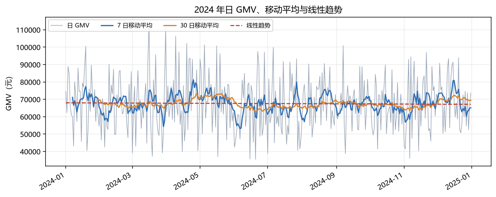
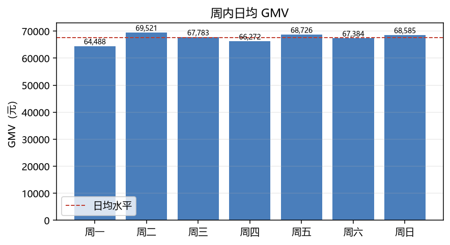
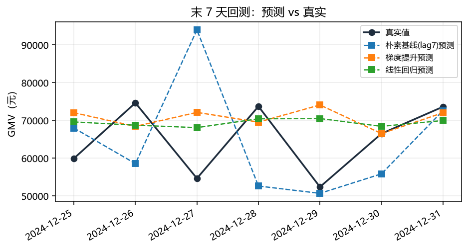
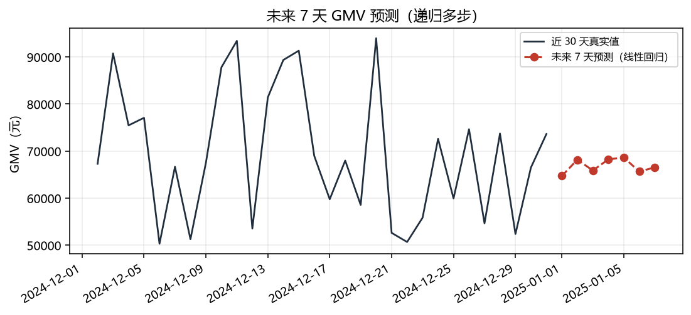

# 预测建模分析报告

> 项目：云购生活新零售企业 · 企业级数据仓库与经营分析可视化系统
> 周次：第 3 周　|　主题：时间序列分析与预测建模
> 数据范围：2024-01-01 ~ 2024-12-31，共 366 天（闰年）
> 复现命令：`python/01_extract_series.py` → `python/02_predict_gmv.py`

---

## 一、结论先行

| 问题 | 结论 |
|---|---|
| 预测什么 | 日 GMV（成交口径），未来 7 天（2025-01-01 ~ 01-07） |
| 效果如何 | 最优可学习模型为线性回归，末 7 天留出集 **MAPE 13.65%**、MAE 8,001.44 元 |
| 是否可用 | **不可用于业务决策**。常数均值基线 MAPE 13.19%，比所有模型都好 |
| 根本原因 | 本数据集由随机过程生成，**没有趋势、没有周季节性、没有促销脉冲**，日 GMV 近似白噪声 |
| 结论价值 | 交付的是**方法论与评估框架**（防泄漏切分、基线对照、边界判断），不是一组可信的预测数字 |

一句话：**这次建模最大的产出，是证明了"不该相信这个模型"。**

---

## 二、数据来源与口径

数据从 ADS 层直接取，避免在 Python 侧重算口径导致数出多门：

```sql
-- python/01_extract_series.py 内部的取数逻辑
SELECT stat_date, gmv, order_cnt, user_cnt, aov
FROM   ydsh_ads.ads_sales_daily
ORDER  BY stat_date
```

| 校验项 | 实测值 | 说明 |
|---|---:|---|
| 天数 | 366 | 2024 为闰年，无缺口（脚本显式检查，缺口 0 天） |
| GMV 合计 | 24,717,464.96 元 | 与 `ads_kpi_overview` 完全一致 |
| 订单合计 | 9,992 单 | 与 DWD 层 `count(distinct order_id)` 一致 |
| 空值 | 0 | gmv / order_cnt / user_cnt / aov 四列均无缺失 |

口径说明：`ads_sales_daily` 已按 `is_gmv_included = 1` 过滤，只含「已支付 / 已完成」，
不含已取消、退款中、待支付。**这一点是第 2 周踩过的坑**（直接对 15,000 单求和会虚增约 50%），
此处不再赘述，详见《09_指标口径与ADS设计.md》第 1.2 节。

---

## 三、描述性分析

### 3.1 趋势：基本走平，略向下

| 指标 | 数值 |
|---|---:|
| 日均 GMV | 67,534.06 元 |
| 线性趋势斜率 | **−2.32 元/天**（折合 −0.10% / 月） |
| 最高日 | 113,424.59 元（03-16） |
| 最低日 | 35,402.70 元（06-20） |
| 日 GMV 变异系数（CV） | **0.230** |

斜率折算下来一年只跌 3.6%，相对日均水平属于噪声级别。CV = 0.230 说明日间波动约为均值的 23%，
对于「无促销、无季节性」的平稳零售数据，这个量级是合理的——**波动大，但没有方向**。



上图中 7 日与 30 日移动平均几乎没有分离，红线趋势近乎水平，直观印证"无趋势"的判断。

### 3.2 周内效应：不存在

| 周一 | 周二 | 周三 | 周四 | 周五 | 周六 | 周日 |
|---:|---:|---:|---:|---:|---:|---:|
| 64,487.72 | 69,520.79 | 67,783.12 | 66,271.52 | 68,726.38 | 67,384.40 | 68,584.84 |

最强（周二）÷ 最弱（周一）= **1.078 倍**。

真实零售数据通常有明确的周末翘尾（1.2~1.5 倍），这里 7.8% 的差距在 52 个样本下不具统计显著性。
**结论：`weekday` / `is_weekend` 特征在本数据集上是纯噪声，应被模型自动降权——这也是后面模型
表现不如均值基线的原因之一。**



### 3.3 月度与环比

| 月份 | GMV（元） | 订单量 | 客单价（元） | 环比 |
|---|---:|---:|---:|---:|
| 2024-01 | 2,158,419.33 | 856 | 2,521.52 | — |
| 2024-02 | 1,926,681.97 | 778 | 2,476.45 | −10.74% |
| 2024-03 | 2,059,336.96 | 841 | 2,448.68 | +6.89% |
| 2024-04 | 2,100,538.89 | 824 | 2,549.20 | +2.00% |
| 2024-05 | 2,190,666.12 | 877 | 2,497.91 | +4.29% |
| 2024-06 | 1,925,359.38 | 770 | 2,500.47 | −12.11% |
| 2024-07 | 2,003,105.58 | 811 | 2,469.92 | +4.04% |
| 2024-08 | 2,144,055.03 | 883 | 2,428.15 | +7.04% |
| 2024-09 | 2,020,216.92 | 832 | 2,428.15 | −5.78% |
| 2024-10 | 2,020,164.99 | 855 | 2,362.77 | −0.00% |
| 2024-11 | 2,018,095.88 | 805 | 2,506.95 | −0.10% |
| 2024-12 | 2,150,823.91 | 860 | 2,500.96 | +6.58% |

月度极差率仅 **12.11%**（最低的 2024-06 相对最高的 2024-05），且没有连续下滑或连续上升的走势。
真实零售常见的春节（2 月）、618（6 月）、双 11（11 月）脉冲在这里**完全不存在**——
2024-02 反而环比 −10.74%，2024-11 环比 −0.10%，与真实电商规律相反。
这是判断"数据为随机生成"最直接的证据。

---

## 四、特征工程与防泄漏设计

| 特征组 | 具体特征 | 设计理由 |
|---|---|---|
| 滞后 | `lag1` ~ `lag7` | 捕捉短期自相关；7 阶覆盖一个完整周周期 |
| 移动平均 | `ma7`、`ma14` | 平滑噪声、提供水平基准 |
| 日历 | `weekday`、`day_of_month`、`is_weekend` | 捕捉周内 / 月内节律 |
| 目标 | `gmv` | 连续值回归 |

**关键防泄漏处理**（这是时间序列建模最容易出错的地方）：

```python
# ma7 必须先 shift(1) 再 rolling(7)
out["ma7"] = out[TARGET].shift(1).rolling(7).mean()
```

如果写成 `rolling(7).mean()`，当天的 GMV 会参与当天的 `ma7` 计算，
相当于把答案喂进特征，回测 MAPE 会"好得离谱"，上线后立刻崩塌。
同理，切分必须按时间顺序取末 7 天，**绝不能用 `train_test_split(random_state=42)`**——
随机切分会让模型在 2024-03 的数据上学习、却去预测 2024-01，属于未来信息泄漏。

经过 `lag14` 的预热丢弃，有效样本 337 条，训练 330 / 测试 7。

---

## 五、模型与评估结果

### 5.1 候选模型

| 模型 | 角色 | 配置 |
|---|---|---|
| 常数均值基线 | **及格线** | 直接输出训练集均值，不学习任何东西 |
| 朴素基线（lag7） | 及格线 | 预测值 = 上周同一天，零售预测的行业惯例基线 |
| 线性回归 | 可学习模型 | sklearn 默认参数 |
| 随机森林 | 可学习模型 | 300 棵树，max_depth=6，min_samples_leaf=3 |
| 梯度提升 | 可学习模型 | 200 轮，max_depth=3，lr=0.05 |

加两条基线的目的很直接：**没有基线的模型指标毫无意义**。
孤零零地说"MAPE 13.65%"，听起来不错；但只有当它显著优于"直接猜均值"，
才说明模型真的学到了东西。

### 5.2 回测结果（末 7 天，按时间切分）

| 模型 | MAE（元） | RMSE（元） | MAPE | R² |
|---|---:|---:|---:|---:|
| **常数均值基线** | **7,978.18** | **9,049.80** | **13.19%** | **−0.0662** |
| 朴素基线（lag7） | 13,992.38 | 18,644.20 | 22.31% | −3.5252 |
| 线性回归 | 8,001.44 | 9,748.04 | 13.65% | −0.2370 |
| 随机森林 | 9,072.15 | 10,677.06 | 15.14% | −0.4841 |
| 梯度提升 | 9,044.91 | 11,845.73 | 15.69% | −0.8267 |



### 5.3 三个必须讲清楚的读数

**第一，所有模型的 R² 都是负数。** R² 为负不是"拟合得不够好"，而是**比直接用均值预测还差**。
线性回归 R² = −0.237 意味着：在末 7 天这个窗口上，它的平方误差比常数均值预测大 23.7%。

**第二，线性回归（13.65%）没有跑赢常数均值（13.19%）。** 差距 0.46 个百分点，
在 7 个测试点上完全在噪声范围内。脚本已经把这条写成显式告警：

```
[WARN] 未战胜常数均值基线（13.19%）：模型学到的增量信息 ≈ 0，
       预测结果只能当参考区间，不具备业务决策价值
```

**第三，梯度提升和随机森林反而更差（15.14% / 15.69%）。** 树模型擅长拟合非线性结构，
在完全没有结构的白噪声上，它们会把训练集的随机波动记成"规律"，
正是**过拟合的教科书表现**。复杂模型不等于更好的预测，这是本周最实用的一课。

---

## 六、批判性审视：模型为什么没用

| 原因 | 证据 | 影响 |
|---|---|---|
| 数据无结构 | 趋势 −0.10%/月、周内极差 7.8%、月度极差 12.1% 且无周期 | 任何模型都只能输出接近均值的常数 |
| 样本量太小 | 337 条有效样本，测试集仅 7 条 | 指标估计本身不可靠，MAPE 波动可达数个百分点 |
| 单变量输入 | 只有历史 GMV，没有促销、流量、投放、节假日 | 真实 GMV 的驱动因素根本不在特征里 |
| 递归多步误差累积 | 预测第 t+2 天时，`lag1` 已用 t+1 的预测值 | 7 步递归后误差放大，越远越不可信 |
| MAPE 对低值日敏感 | 最低日 35,402.70 元，仅为均值的 52% | 同样的绝对误差在低值日会被放大近 2 倍 |
| 测试集单窗口 | 只做了 1 次 7 天回测，未做滚动回测 | 结论可能是这一周的偶然，缺少稳健性验证 |

### 那么这套流程的价值在哪

1. **框架可复用**：换真实数据、加促销特征后，`build_features` 与评估代码不用改。
2. **基线意识**：先问"打败均值了吗"，能挡掉绝大多数"看起来很准"的伪模型。
3. **防泄漏纪律**：`shift(1)` 与时间切分写进了代码注释，不是口头约定。
4. **诚实披露**：负 R²、未战胜基线这些"不好看"的结果全部保留在报告里，
   而不是挑一个好看的窗口。

> **如果这是真实业务场景，正确的做法不是上线这个模型，而是：**
> ① 先补齐促销日历、投放费用、流量、库存等外部变量；
> ② 用滚动回测（rolling-origin）替代单窗口回测；
> ③ 输出预测**区间**而非点估计，供备货决策做安全库存参考。

---

## 七、未来 7 天预测

模型：线性回归（全量 337 条重训，递归 7 步）

| 日期 | 预测 GMV（元） | 参考区间 ±1.28×RMSE（80%） |
|---|---:|---:|
| 2025-01-01 | 64,734.35 | 52,257 ~ 77,211 |
| 2025-01-02 | 68,181.47 | 55,704 ~ 80,659 |
| 2025-01-03 | 65,887.26 | 53,410 ~ 78,364 |
| 2025-01-04 | 68,246.89 | 55,770 ~ 80,724 |
| 2025-01-05 | 68,649.19 | 56,172 ~ 81,126 |
| 2025-01-06 | 65,662.51 | 53,185 ~ 78,140 |
| 2025-01-07 | 66,544.74 | 54,068 ~ 79,022 |
| **7 天合计** | **467,906.41** | — |



区间说明：用末 7 天回测的 RMSE（9,748.04）按正态近似取 80% 区间，**±12,477 元的区间宽度约为
预测值本身的 19%**，这个宽度已经大到无法支撑任何具体备货或预算决策。
区间是按单日独立误差近似，递归预测下实际误差相关性更强，真实区间应更宽。
7 个测试点也无法可靠估计误差分布，该区间仅作量级参考。

**预测值全部落在 64,700 ~ 68,700 元之间，本质上是"日均水平的复读"，不应被解读为趋势判断。**

---

## 八、改进路径（按性价比排序）

| 优先级 | 改进 | 预期收益 | 成本 |
|---|---|---|---|
| 1 | 补促销 / 节假日日历特征 | 高——真实零售波动的主要来源 | 低，一张日期维度表即可 |
| 2 | 换滚动回测（rolling-origin，如 5 折扩展窗口） | 高——指标从"单点"变"分布" | 中，需改评估循环 |
| 3 | 引入外部变量（流量、投放、库存、天气） | 高 | 高，需新数据源 |
| 4 | 改用梯度提升 + 早停 + 交叉验证调参 | 中 | 中 |
| 5 | 概率预测（分位数回归 / QuantileForest） | 中——直接给区间，替代正态近似 | 中 |
| 6 | 换成 Prophet / statsmodels SARIMAX | 低——本数据无季节性可建模 | 低，但收益也低 |

第 1 项是唯一"低成本高收益"的改进，也是本项目下一步最该做的事。

---

## 九、复现与产物

```bash
# 前置：DWS/ADS 已就绪（./run_all.sh week3）
cd python
python 01_extract_series.py    # 从 ADS 抽取日/月序列 → output/daily_gmv.csv, monthly_kpi.csv
python 02_predict_gmv.py       # 训练 + 回测 + 预测 + 出图
```

| 产物 | 路径 | 内容 |
|---|---|---|
| 日序列 | `output/daily_gmv.csv` | 366 行，含 gmv / order_cnt / user_cnt / aov / ma7 |
| 月度序列 | `output/monthly_kpi.csv` | 12 行，含环比 |
| 模型指标 | `output/model_metrics.csv` | 5 个模型的 MAE / RMSE / MAPE / R² |
| 预测结果 | `output/forecast_next7.csv` | 7 行预测值 |
| 图 1~4 | `docs/images/fig_0[1-4]_*.png` | 趋势 / 周内 / 回测 / 预测 |
| 运行日志 | `logs/py_02_predict.log` | 完整控制台输出，含告警 |

所有数字均由脚本实际运行产生，无手工填写。
